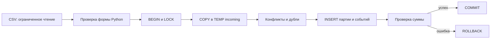

# Конспект: атомарная загрузка мини-склада

20.10.2026, версия 0.1.0. Новый инструмент — PostgreSQL 16.15 с Psycopg 3.3.6.
[Команды](README.md), [карта кода](START_HERE.md), [решения](DECISIONS.md),
[практика](EXERCISES.md). Это учебная работа на синтетических данных.

## 1. Задача простыми словами

На склад приходят файлы движений товаров. Приход увеличивает количество, расход
уменьшает. Файл могут прислать повторно, а отдельное событие может встретиться
в разных файлах. Нельзя удвоить приход, молча изменить прошлое движение или принять
только удобную часть ошибочной партии. На выходе нужен проверяемый остаток по SKU.

Пример: E0001 добавляет десять BOOK, E0004 списывает три. Получается семь.
Если второй файл снова содержит старый приход E0002 PEN +20, это не новый приход:
после расхода четырёх PEN должно остаться шестнадцать, а не тридцать шесть.
Если расход BAG делает остаток отрицательным, весь его файл отклоняется вместе
с другими строками. Так таблица не изображает неполную загрузку как успешную.

## 2. Что изучаем и почему PostgreSQL

Предыдущий проект на Prefect управлял порядком шагов. Он не превращал несколько
записей в общую транзакцию. Здесь изучаем именно приёмник: транзакцию, staging,
ограничения ключей, массовый COPY и взаимодействие двух клиентов.

Транзакция объединяет действия между BEGIN и COMMIT. Если внутри возникло исключение,
контекст Psycopg вызывает ROLLBACK. Атомарность означает «все изменения партии либо
ни одного», изоляция определяет видимость параллельных действий, ограничения
поддерживают выбранные правила структуры. Долговечность обычного PostgreSQL не
означает, что наше демо хранит данные навсегда: временный кластер специально удаляется.

SQLite тоже подходит небольшому складу, но уже изучался в серии. PostgreSQL выбран
для реальных серверных соединений, COPY и наблюдаемой блокировки писателей.
ORM не нужен: короткий SQL явно показывает, какие таблицы и когда меняются.
Psycopg выполняет параметры и адаптацию типов; Python не конструирует SQL из строк CSV.

## 3. Данные и контракт

Одна строка — неизменяемое событие. Поля: event_id, sku, delta. ID имеет вид E0001,
SKU — от двух до шестнадцати символов из заглавных латинских букв, цифр и подчёркивания,
первая буква обязательна. delta — ненулевое целое от -99999 до 99999. Положительное
значение означает приход, отрицательное расход. Здесь один склад и целые единицы,
нет валюты, цены и времени события. Следовательно, нет ответа «сколько было вчера».

Заголовок и порядок колонок строгие. UTF-8 BOM, LF и CRLF допустимы. Числа с плюсом,
пробелами, ведущими нулями, дробями и экспонентой отклоняются. Проверка формы не
обрезает и не исправляет неоднозначное значение молча. Пустой файл не является
успешной нулевой партией. Предел на файл — миллион байт и десять тысяч строк.

Генератор использует константы, не внешние данные и не случайный seed. receipts
содержит четыре строки: BOOK +10, PEN +20, BAG +5 и точную копию первого события.
dispatch содержит BOOK -3, PEN -4, BAG -2 и старый E0002 PEN +20. Остальные файлы
создают отрицательный остаток, конфликт и управляемый отказ. Имена вымышленные.

Одинаковые event_id/sku/delta — дубль. Одинаковый ID с другим payload — конфликт.
Прежнее событие не обновляется: без версии и временной модели нельзя решить,
какая запись правильнее. Исправление допускается новым компенсирующим событием.
Четыре цифры ID также ограничивают учебную модель десятью тысячами разных событий
за всё время базы; это осознанный маленький контракт, не масштабный промышленный ID.

## 4. Архитектура и состояние



В stock_lab.batches сохраняются ключ партии, SHA-256 входа и счётчики. В events
сохраняются уникальное событие и ссылка на партию, которая впервые его внесла.
View balances группирует события и суммирует delta; отдельной изменяемой копии
остатков нет. Meta хранит версию схемы. Случайно найденная несовместимая схема
не удаляется и не «мигрируется» догадками.

Ключ batch_id задаёт вызывающая сторона. Его нельзя брать из текущего времени
при каждом retry: это уже другой ключ загрузки. Хэш связывает ключ с исходными
байтами. С тем же batch_id другой файл запрещён, даже если отличается только LF/CRLF.
Новый batch_id с прежними событиями допустим: партия зарегистрируется, новых событий
может быть ноль. Так границы партии и бизнес-события остаются разными.

## 5. Разбор транзакции и SQL

read_csv сначала читает не больше MAX_BYTES + 1, проверяет UTF-8 и строки,
возвращает список типизированных троек и хэш именно прочитанных байтов. Файл
не читается повторно для хэша, поэтому данные и контрольная сумма относятся к
одному набору. Пакет целиком находится в памяти; это не потоковый обработчик.

load_batch открывает autocommit-соединение и явный `conn.transaction()`. Autocommit
здесь позволяет самому выбрать начало транзакции, а не случайно начать её первым
служебным SELECT. После проверки версии загрузчик блокирует batches и events
в SHARE ROW EXCLUSIVE. Затем проверяет уже принятую партию: совпавший хэш возвращает
reused=true, несовпавший вызывает отказ.

COPY идёт через клиентское соединение в TEMP incoming. Серверу не передаётся
локальный путь, поэтому ему не требуется доступ к файлам приложения. Таблица
исчезает при COMMIT, а её создание при ошибке откатывается. Сначала проверяется:

```sql
SELECT event_id FROM incoming GROUP BY event_id
HAVING count(DISTINCT (sku, delta)) > 1;
```

Это отличает точную копию от двух разных событий с одним ID. Далее JOIN с постоянной
events выявляет противоречие с историей. Только после этого можно использовать
DISTINCT и ON CONFLICT DO NOTHING. Если сразу игнорировать любой конфликт ключа,
E0001 BOOK +11 выглядел бы как безобидный повтор E0001 BOOK +10.

Перед событиями вставляется родительская партия: FK проверяет её существование.
INSERT RETURNING сообщает, сколько событий добавлено впервые. В receipts входных
строк четыре, уникальных ID три, вставлено три. В dispatch уникальных ID четыре,
но вставлено три: E0002 уже существует. Статистика inserted_events в повторном
результате — исторический результат той партии, а не новые вставки этого запуска.

После INSERT запрос ищет balances.quantity < 0. При обнаружении Python поднимает
DataError внутри контекста транзакции. Откатываются и события, и запись партии.
При успехе обновляется счётчик и выход из контекста выполняет COMMIT до возврата
результата. Техническое committed_at не включено в воспроизводимый JSON.

Проведём строки вручную. BOOK: +10 -3 = 7. PEN: +20 -4 = 16; старый E0002 пропущен.
BAG: +5 -2 = 3. Получается шесть событий и две партии. В negative есть BOOK +2 и
BAG -99. Проверка BAG не проходит, поэтому BOOK остаётся семь, а не девять.

## 6. Конкуренция и согласованный отчёт

Без блокировки два клиента могут увидеть BOOK=10, независимо разрешить расход -7
и вместе получить -4. В нашем загрузчике один писатель удерживает блокировку до
COMMIT/ROLLBACK, другой ждёт. При стандартном READ COMMITTED следующий запрос
после ожидания видит уже принятое изменение и пересчитывает остаток правильно.
Интеграционная проверка запускает оба клиента: принимается один, второй отклоняется,
итог BOOK=3. Отдельный тест удерживает блокировку и доказывает, что Future писателя
не завершается до её освобождения.

Это глобальная сериализация всего маленького склада, не обещание высокой
пропускной способности. Порядок блокировки таблиц одинаков у всех загрузок.
Обычные SELECT совместимы с этим режимом и могут читать старую принятую версию.
Отчёт выполняет несколько SELECT в REPEATABLE READ READ ONLY: balances, число
событий и список партий относятся к одному снимку. Он может быть немного старее
последнего COMMIT, но не смешивает разные моменты между своими запросами.

PK, FK и CHECK действительно живут в БД. Однако неотрицательная сумма — проверка
приложения под блокировкой, а не CHECK одной строки. Владелец базы с произвольным SQL
может обойти её. Производственные роли и запрет обходных записей здесь не реализованы.

## 7. Сбои и восстановление

Ошибка формы возникает до подключения. Конфликт payload и отрицательный остаток
возникают внутри транзакции и не оставляют принятой партии. Управляемый DemoFailure
вызывается после INSERT перед COMMIT; тест сравнивает полный снимок до/после и
затем успешно загружает те же байты тем же ключом. Исключение не исправляет данные,
но атомарность делает повтор технически возможным.

Если соединение потеряно в момент COMMIT, клиент может не знать, принят ли пакет.
Правильный шаг — повторить прежний batch_id с прежними байтами. Сервер либо найдёт
совпавшую партию, либо выполнит её впервые. Это ограниченная идемпотентность одного
приёмника, не распределённая гарантия exactly-once и не автоматическая политика retry.
Новая случайная метка загрузки не решает неопределённость её исхода.

Каждый файл workshop принимается отдельной транзакцией: отказ второго не отменяет
уже принятую первую партию. Общий отчёт experiences/steps.json — обычный файл,
на него не распространяется транзакция PostgreSQL. После демонстрации сервер
останавливается и свой кластер удаляется; пользовательские CSV и отчёт остаются.

## 8. Проверки и реальные наблюдения разработки

Первый демонстрационный запуск и первые тринадцать интеграционных проверок прошли
без исправления ядра. Ошибку разработки ради красивой истории не придумываем.
Обнаружено практическое свойство среды: initdb и pg_ctl установлены, но не находятся
в обычном PATH, поэтому helper умеет брать каталог через pg_config --bindir.

Публикация снова встретила внешнее ограничение: браузер не смог проверить политику
администратора для GitHub. Репозиторий проекта через API не найден. Это не ошибка
SQL и не основание утверждать, что пустой репозиторий или готовый ZIP уже опубликован.
Фактические проверки и последующее состояние записываются в VALIDATION.md.

Быстрые тесты проверяют форму CSV, границы, хэш, отсутствие перезаписи и коды CLI.
Интеграционные используют настоящий PostgreSQL, включая конкурентные соединения,
rollback и реальные CHECK. Невозможность запустить сервер даёт ошибку тестов,
не скрытый skip. Тестовая внешняя база разрешена только с именем stock_test.

## 9. Ограничения и дальнейшее развитие

Нет времени событий, нескольких складов, резервов и истории «на дату». Проверяем
конечный остаток всей партии: расход перед приходом внутри одного файла допустим,
если конечная сумма неотрицательна. Это бизнес-допущение, не свойство PostgreSQL.
Размер и ID ограничены; полное суммирование журнала со временем станет дорогим.
Длительные паузы отладчика могут превысить короткий lock_timeout.

Дальше можно добавить отдельные остатки с блокировками строк SKU в одинаковом порядке,
но это потребует транзакционно поддерживать два представления состояния и проверить
создание нового SKU. Удалять текущий LOCK без замены механизма нельзя. Миграции,
роли доступа, принудительное завершение ОС и авария питания не проверялись.

## 10. Вопросы и практика

Честная формулировка: «В учебном проекте загрузил CSV через COPY, отделил партии
от событий и проверил откат и конкурентные записи настоящими соединениями».

- Почему одного ON CONFLICT мало? Он не отличает повтор payload от противоречия истории.
- Что откатывает transaction()? Изменения БД в её границе, не произвольный JSON на диске.
- Зачем хэш рядом с batch_id? Чтобы повтор ключа не скрыл изменённый вход.
- Почему CHECK не гарантирует сумму склада? Это межстрочный инвариант, реализованный протоколом записи.
- Зачем отчёту отдельная изоляция? Несколько запросов должны относиться к одному снимку.

Пять упражнений с командами и ответами находятся в EXERCISES.md: изменить расход
до -8 и получить BOOK=2; вызвать полный откат расходом -30; различить дубль и конфликт;
добавить показатели received/dispatched; исследовать ожидание блокировки. Для нового
правила сначала запиши ожидаемые числа, затем добавь проверку до усложнения архитектуры.

## 11. Официальные источники

- [PostgreSQL 16.15](https://www.postgresql.org/docs/16/release-16-15.html) — версия доступного сервера.
- [Транзакции](https://www.postgresql.org/docs/16/tutorial-transactions.html) — BEGIN/COMMIT/ROLLBACK.
- [LOCK](https://www.postgresql.org/docs/16/sql-lock.html) и [изоляция](https://www.postgresql.org/docs/16/transaction-iso.html) — режимы взаимодействия клиентов.
- [Psycopg COPY](https://www.psycopg.org/psycopg3/docs/basic/copy.html) — передача строк через соединение.
- [Контексты транзакций](https://www.psycopg.org/psycopg3/docs/basic/transactions.html) — управление COMMIT/ROLLBACK.

Границы партии, формат ID, глобальная блокировка и политика конфликтов — конкретные
решения этого учебного приложения; инструмент не выбирает их автоматически.
